# rest-api: 글/댓글 REST API

Spring Boot로 만든 게시판 백엔드입니다. 글(Post)과 댓글(PostComment)을 JSON으로 조회하고 삭제할 수 있습니다.
화면은 프론트 앱이 그린다고 가정하고, 이 서버는 데이터만 응답합니다.

참고 자료: [slog.gg/p/14172](https://www.slog.gg/p/14172) 1~19강 (REST API 1부)

- **스택**: Java 25, Spring Boot 4.1.2, Spring Data JPA, H2, Lombok, Gradle(Kotlin DSL)
- **스펙과 티켓**: [#1 스펙](https://github.com/zoek1211/rest-api/issues/1), 하위 티켓 #5~#10
- **용어**: [GLOSSARY.md](GLOSSARY.md) (글 = Post, 댓글 = PostComment, 결과코드 = resultCode, 샘플데이터)

> 소스 코드 곳곳에 공부용 주석을 자세히 달아 두었습니다. 아래 커밋 설명을 읽고, 해당 커밋의 파일을 열어 주석과 함께 보면 좋습니다.

---

## 목차

1. [실행 방법](#실행-방법)
2. [API 한눈에 보기](#api-한눈에-보기)
3. [패키지 구조](#패키지-구조)
4. [커밋별 설명](#커밋별-설명)
5. [핵심 개념 정리](#핵심-개념-정리)

---

## 실행 방법

```bash
./gradlew bootRun
```

- 처음 실행할 때 Java 25가 없으면 Gradle이 자동으로 내려받습니다(`~/.gradle/jdks`).
- 앱이 뜨면 샘플데이터(글 3개, 댓글 5개)가 자동으로 만들어집니다.
- 브라우저에서 http://localhost:8080/api/v1/posts 를 열어 보세요.

테스트 실행:

```bash
./gradlew test
```

DB를 처음 상태로 되돌리고 싶을 때(엔티티 필드 이름을 바꿨을 때도):

```bash
rm -f db_dev.*
```

### H2 콘솔

http://localhost:8080/h2-console 에 접속합니다.

| 항목 | 값 |
|---|---|
| Driver Class | `org.h2.Driver` |
| JDBC URL | `jdbc:h2:./db_dev;MODE=MySQL` |
| User Name | `sa` |
| Password | (비워 둠) |

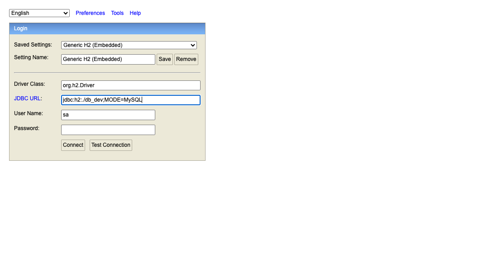

---

## API 한눈에 보기

| 메서드 | URL | 설명 | 응답 |
|---|---|---|---|
| GET | `/api/v1/posts` | 글 다건조회 | `PostDto[]` |
| GET | `/api/v1/posts/{id}` | 글 단건조회 | `PostDto` |
| GET | `/api/v1/posts/{id}/delete` | 글 삭제 (댓글도 함께 삭제) | `RsData<Void>` |
| GET | `/api/v1/posts/{postId}/comments` | 댓글 다건조회 | `PostCommentDto[]` |
| GET | `/api/v1/posts/{postId}/comments/{id}` | 댓글 단건조회 | `PostCommentDto` |
| GET | `/api/v1/posts/{postId}/comments/{id}/delete` | 댓글 삭제 | `RsData<Void>` |

> 삭제를 GET으로 하는 것은 브라우저 주소창으로 쉽게 테스트하기 위한 **임시** 방식입니다.
> 원래는 `DELETE /api/v1/posts/{id}`처럼 DELETE 메서드를 써야 합니다(이후 단계에서 변경 예정).

---

## 패키지 구조

```
src/main/java/com/back
├── BackApplication.java                 # 시작점, @EnableJpaAuditing
├── domain/post
│   ├── post                             # 글
│   │   ├── controller/ApiV1PostController.java
│   │   ├── dto/PostDto.java
│   │   ├── entity/Post.java             # 댓글 목록을 소유(애그리거트 루트)
│   │   ├── repository/PostRepository.java
│   │   └── service/PostService.java     # 글 + 댓글 로직
│   └── postComment                      # 댓글
│       ├── controller/ApiV1PostCommentController.java
│       ├── dto/PostCommentDto.java
│       └── entity/PostComment.java
└── global
    ├── jpa/entity/BaseEntity.java       # id, createDate, modifyDate 공통 필드
    ├── rsData/RsData.java               # 조회 외 요청의 응답 봉투
    └── sampleData/SampleData.java       # 앱 시작 시 샘플데이터 생성
```

요청이 흐르는 순서는 **Controller → Service → Repository → DB**입니다.
댓글 전용 Service/Repository는 없습니다. 댓글은 항상 "글을 먼저 찾고, 그 글을 통해" 다룹니다.

---

## 커밋별 설명

각 커밋 제목을 누르면 GitHub에서 그 커밋의 변경 내용을 볼 수 있습니다.

### 0. [`0bd9f38`](https://github.com/zoek1211/rest-api/commit/0bd9f38) docs: 에이전트 스킬 설정, 작업지침, 용어집 추가

코드 작업 전에 프로젝트 문서부터 정리했습니다.

- `CLAUDE.md`: 작업 흐름(요구사항 정리 → 스펙 → 티켓 → TDD 구현 → 코드리뷰)과 작업지침
- `GLOSSARY.md`: 프로젝트에서 쓰는 용어를 하나로 통일(예: "게시글", "Article" 대신 **글(Post)**)
- `docs/agents/`: 이슈 트래커(GitHub)와 라벨 설정

### 1. [`3252734`](https://github.com/zoek1211/rest-api/commit/3252734) feat: 프로젝트 세팅 (티켓 #5)

[start.spring.io](https://start.spring.io)에서 프로젝트를 생성하고 DB 설정을 했습니다.

- **의존성**: webmvc(웹 + JSON), data-jpa(ORM), validation, h2, h2console, lombok, devtools
- **프로필 분리**
  - `dev`(기본값): 파일 DB `db_dev`. 재시작해도 데이터가 남습니다.
  - `test`: 메모리 DB `db_test`. 테스트가 개발 데이터를 건드리지 않습니다.
- **`@EnableJpaAuditing`**: 생성일/수정일을 자동으로 채우는 기능을 켭니다.
- **foojay 플러그인**: PC에 Java 25가 없으면 자동으로 내려받습니다.

📖 볼 파일: `build.gradle.kts`, `application.yaml`, `application-dev.yaml`, `application-test.yaml`

### 2. [`0c9d647`](https://github.com/zoek1211/rest-api/commit/0c9d647) feat: 글/댓글 엔티티와 샘플데이터 자동 생성 (티켓 #6)

DB 테이블에 대응하는 엔티티 클래스를 만들고, 앱을 시작할 때 샘플데이터를 넣습니다.

- **`BaseEntity`**: 모든 엔티티의 공통 필드(id, createDate, modifyDate)를 `@MappedSuperclass`로 묶었습니다.
- **`Post` ↔ `PostComment` 양방향 관계**
  - `PostComment.post`: `@ManyToOne(fetch = LAZY)`. 외래키 `post_id`를 가진 쪽이자 연관관계의 주인입니다.
  - `Post.comments`: `@OneToMany(mappedBy = "post", cascade = {PERSIST, REMOVE}, orphanRemoval = true)`
- **샘플데이터**: 글이 0개일 때만 글 3개, 댓글 5개를 만듭니다. 댓글은 `post.addComment()`만 호출해도 cascade PERSIST로 저장됩니다.
- **self 주입 + `@Lazy`**: 같은 클래스 안에서 `@Transactional` 메서드를 호출하면 트랜잭션이 걸리지 않습니다. 그래서 프록시인 자기 자신(`self`)을 주입받아 그걸로 호출합니다.

샘플데이터가 들어간 DB 모습 (`POST_COMMENT.POST_ID`가 외래키):

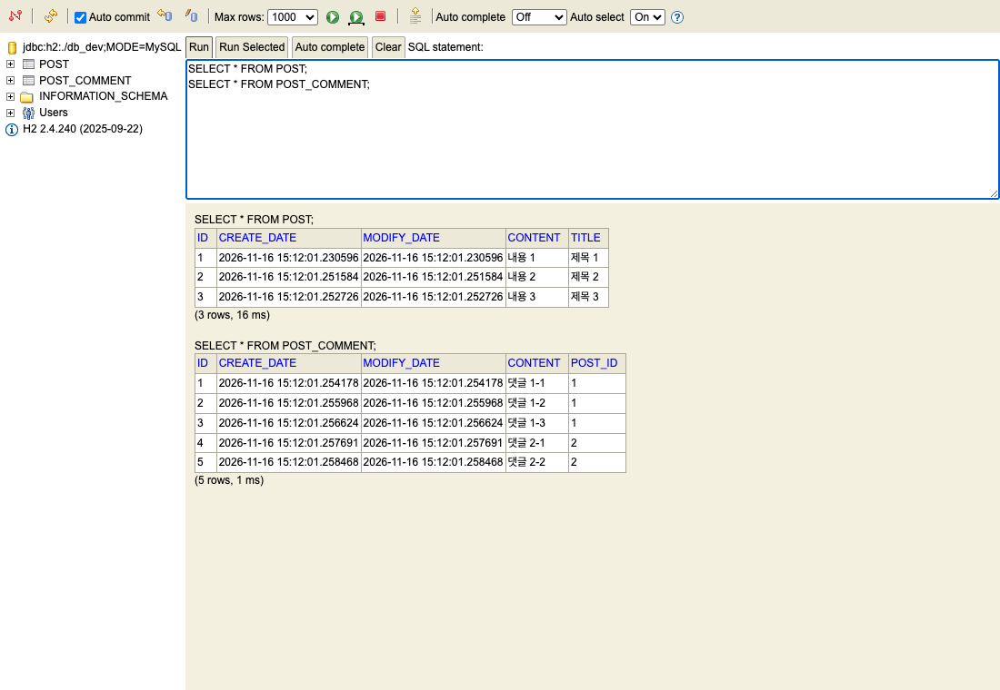

📖 볼 파일: `BaseEntity.java`, `Post.java`, `PostComment.java`, `SampleData.java`(이 커밋에서는 `BaseInitData.java`)

### 3. [`8c0c976`](https://github.com/zoek1211/rest-api/commit/8c0c976) feat: 글 다건/단건 조회 API, PostDto 도입 (티켓 #7)

첫 번째 API입니다. 테스트를 먼저 쓰고(RED), 통과하도록 구현(GREEN)하는 TDD로 진행했습니다.

- **`@RestController`** = `@Controller` + `@ResponseBody`. 반환한 객체가 JSON으로 바뀌어 응답됩니다.
- **`@RequestMapping("/api/v1/posts")`**: 공통 URL 접두어입니다. `v1`은 API 버전입니다.
- **엔티티 대신 `PostDto`(record)로 응답하는 이유**
  1. 엔티티를 그대로 내보내면 글 → 댓글 → 글 → … 순환참조로 Jackson이 무한 루프에 빠집니다.
  2. 글 목록에 필요 없는 댓글까지 노출됩니다.
  3. API 필드 이름을 바꿔 달라는 요구가 와도 엔티티(DB)는 그대로 두고 DTO만 고치면 됩니다.
- `.map(PostDto::new)`: 엔티티 리스트를 DTO 리스트로 바꾸는 메서드 참조입니다.

`GET /api/v1/posts`

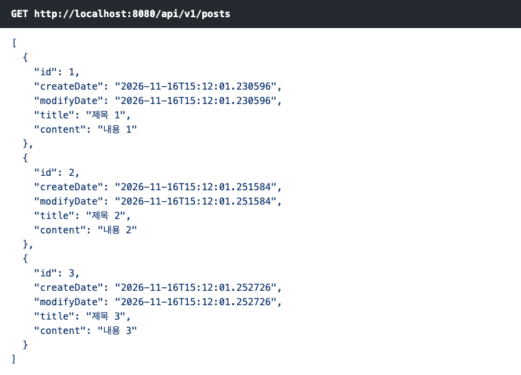

`GET /api/v1/posts/1`: 필드가 정확히 5개이고 `comments`는 없습니다.

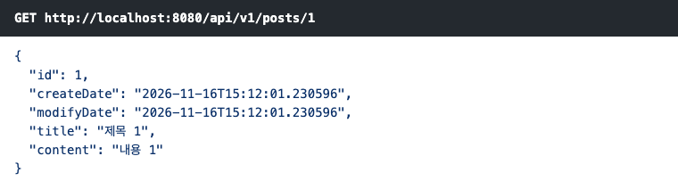

📖 볼 파일: `ApiV1PostController.java`, `PostDto.java`, `ApiV1PostControllerTest.java`

### 4. [`efe43de`](https://github.com/zoek1211/rest-api/commit/efe43de) feat: 댓글 다건/단건 조회 API, PostCommentDto 도입 (티켓 #8)

- **계층형 URL**: `/api/v1/posts/{postId}/comments/{id}` = "postId번 글의 id번 댓글"
- `@PathVariable`이 두 개입니다(`postId`, `id`).
- **`Post.findCommentById()`**: 그 글의 댓글 중에서만 찾습니다. 다른 글의 댓글 id를 넣으면 찾지 못합니다.
- `PostCommentDto`에는 `post` 필드를 넣지 않았습니다. 순환참조를 막고, 글 번호는 URL에 이미 있기 때문입니다.

`GET /api/v1/posts/1/comments`

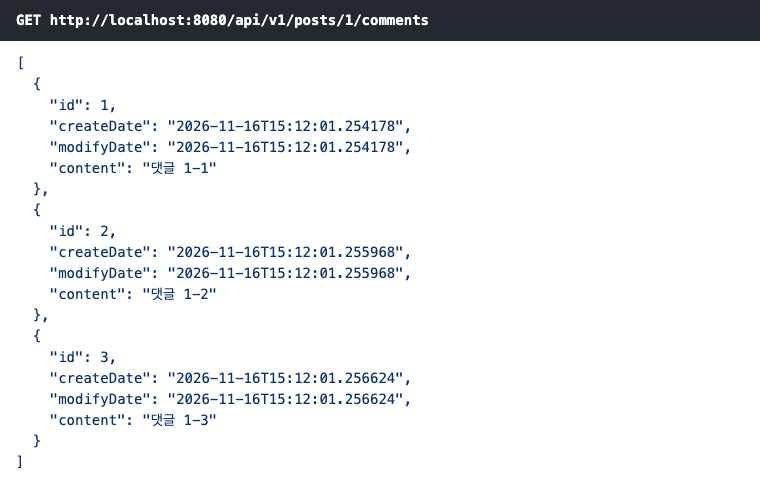

`GET /api/v1/posts/1/comments/2`

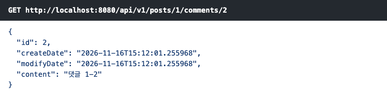

📖 볼 파일: `ApiV1PostCommentController.java`, `PostCommentDto.java`, `Post.java`의 `findCommentById`

### 5. [`678b05b`](https://github.com/zoek1211/rest-api/commit/678b05b) feat: RsData<T> 도입, 댓글 삭제 API (티켓 #9)

- **`RsData<T>(resultCode, msg, data)`**: 조회가 아닌 요청(삭제/작성/수정)의 응답 형식을 하나로 통일합니다.
  - `resultCode`: `HTTP상태코드-세부코드`. 예) `200-1`
  - `msg`: 사람이 읽을 메시지. 프론트가 그대로 알림창에 띄울 수 있습니다.
  - `data`: 추가 데이터. 없으면 `RsData<Void>`로 "비어 있음"을 타입으로 드러냅니다.
- **조회에는 `RsData`를 쓰지 않습니다.** 조회는 대부분 실패할 일이 없어서 DTO를 그대로 주는 편이 단순합니다.
- **댓글 삭제는 DELETE 쿼리를 직접 실행하지 않습니다.**
  1. `post.getComments().remove(댓글)`로 리스트에서 빼기만 합니다.
  2. 트랜잭션이 커밋될 때 JPA가 고아가 된 댓글을 감지하고(`orphanRemoval = true`) delete 쿼리를 실행합니다.
  3. 그래서 **`@Transactional`이 없으면 삭제가 DB에 반영되지 않습니다.**

`GET /api/v1/posts/1/comments/2/delete`

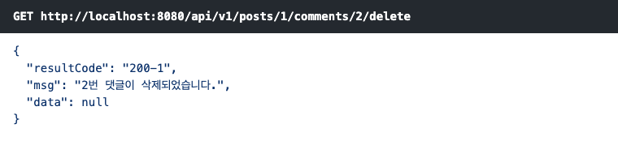

📖 볼 파일: `RsData.java`, `ApiV1PostCommentController.java`의 `delete`, `Post.java`의 `deleteComment`

### 6. [`63652f2`](https://github.com/zoek1211/rest-api/commit/63652f2) feat: 글 삭제 API (댓글 cascade 삭제) (티켓 #10)

- **`cascade = REMOVE`**: 글을 지우면 그 글의 댓글을 먼저 지우고 나서 글을 지웁니다.
  이 설정이 없으면 댓글이 외래키로 글을 참조하고 있어서 글 삭제가 **FK 제약 위반**으로 실패합니다.
- 테스트에서는 `em.flush()`로 delete 쿼리를 실제 DB에 보내서, FK 위반이 나지 않는지까지 확인합니다.

`GET /api/v1/posts/1/delete`

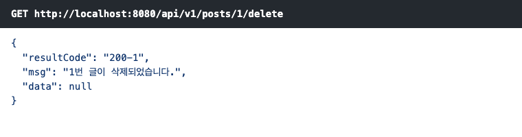

글 삭제 시 실제로 실행된 SQL (콘솔 로그, 순서 그대로):

```sql
select ... from post_comment where post_id=1     -- 1번 글의 댓글 목록 로딩(지연 로딩)
delete from post_comment where id=1             -- cascade REMOVE: 댓글 먼저
delete from post_comment where id=3             -- (2번 댓글은 앞에서 이미 삭제됨)
delete from post where id=1                     -- 마지막으로 글
```

삭제 후 글 목록에는 2, 3번만 남습니다.

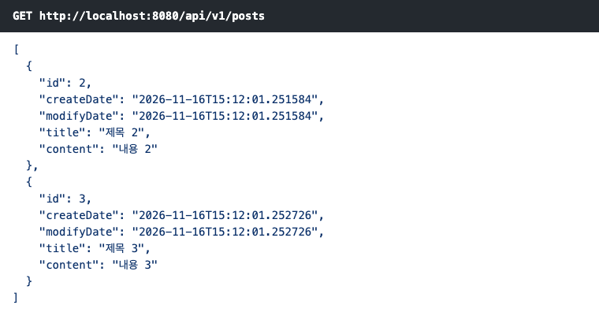

삭제 후 DB를 보면 1번 글과 그 댓글(1, 2, 3번)이 모두 사라지고, 2번 글의 댓글(4, 5번)만 남아 있습니다.

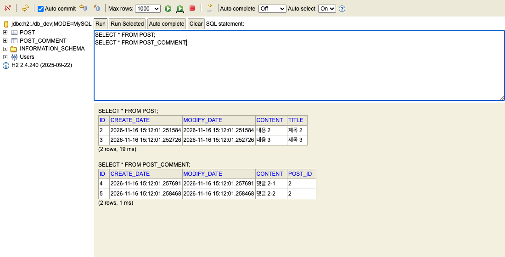

📖 볼 파일: `ApiV1PostController.java`의 `delete`, `ApiV1PostControllerTest.java`의 `delete`

### 7. [`0fced5f`](https://github.com/zoek1211/rest-api/commit/0fced5f) refactor: 코드리뷰 반영

구현을 마친 뒤 코드리뷰(코딩 기준 / 스펙 충족 두 관점)를 받고 반영했습니다.

- `BaseInitData`를 `SampleData`로 바꾸고 `work1()`을 `makeSampleData()`로 바꿨습니다. 용어집의 "샘플데이터"와 맞추고, 메서드 이름만 봐도 하는 일을 알 수 있게 했습니다.
- `spring.h2.console.enabled: true`를 명시했습니다. 전에는 devtools의 기본 설정에 기대고 있었습니다.
- **정렬 보장**: `findAll()`에는 `order by`가 없어서 순서가 DB 마음대로입니다.
  - 글은 `findAll(Sort.by("id"))`로 조회합니다.
  - 댓글 컬렉션에는 `@OrderBy("id")`를 붙였습니다.

### 8. [`d29217e`](https://github.com/zoek1211/rest-api/commit/d29217e) docs: 학습용 상세 주석 추가

모든 소스, 테스트, 설정 파일에 "왜 이렇게 했는지"를 설명하는 주석을 달았습니다.

### 테스트 결과

API 레벨 통합 테스트 7개가 모두 통과합니다(`./gradlew test` → `build/reports/tests/test/index.html`).

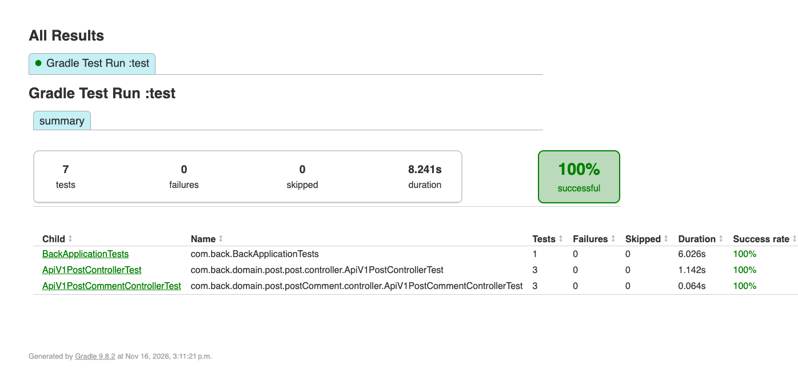

| 테스트 클래스 | 검증 내용 |
|---|---|
| `BackApplicationTests` | 스프링 컨텍스트가 오류 없이 뜨는지 |
| `ApiV1PostControllerTest` | 글 다건조회, 단건조회(필드 5개, comments 없음), 삭제(댓글 cascade) |
| `ApiV1PostCommentControllerTest` | 댓글 다건조회, 단건조회(필드 4개), 삭제 |

---

## 핵심 개념 정리

| 개념 | 한 줄 설명 | 코드 위치 |
|---|---|---|
| `@RestController` | 반환값을 JSON으로 응답 | 두 컨트롤러 |
| API 버저닝 `/v1` | 응답 형식이 크게 바뀌면 `/v2`를 새로 만들어 기존 클라이언트를 보호 | `@RequestMapping` |
| DTO(record) | 엔티티를 숨기고 API 응답 형태만 정의, 순환참조 방지 | `PostDto`, `PostCommentDto` |
| `RsData<T>` | 조회 외 요청의 공통 응답 봉투(resultCode, msg, data) | `RsData` |
| JPA Auditing | createDate/modifyDate 자동 기록 | `BaseEntity`, `@EnableJpaAuditing` |
| `@MappedSuperclass` | 공통 필드를 부모 클래스로 묶음(테이블은 안 생김) | `BaseEntity` |
| 양방향 연관관계 | `@ManyToOne`(주인, FK 보유) ↔ `@OneToMany(mappedBy)` | `PostComment.post`, `Post.comments` |
| 지연 로딩(LAZY) | 실제로 쓸 때 select | `PostComment.post`, `Post.comments` |
| cascade PERSIST / REMOVE | 글 저장·삭제가 댓글로 전파 | `Post.comments` |
| orphanRemoval | 리스트에서 빠진 댓글을 자동 delete | `Post.deleteComment` |
| 더티체킹 | 트랜잭션 커밋 시 변경을 감지해 SQL 실행 → `@Transactional` 필수 | 삭제 메서드 |
| self 주입 | 같은 클래스 내부 호출에도 `@Transactional`이 적용되게 | `SampleData.self` |
| 프로필(dev/test) | 개발용 파일 DB와 테스트용 메모리 DB 분리 | `application-*.yaml` |
| MockMvc 통합 테스트 | 실제 컨테이너 + 가짜 HTTP 요청으로 API 검증, 테스트마다 롤백 | `*ControllerTest` |
